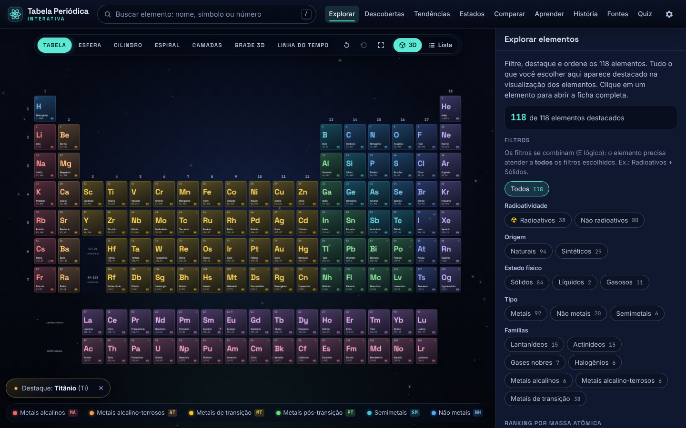
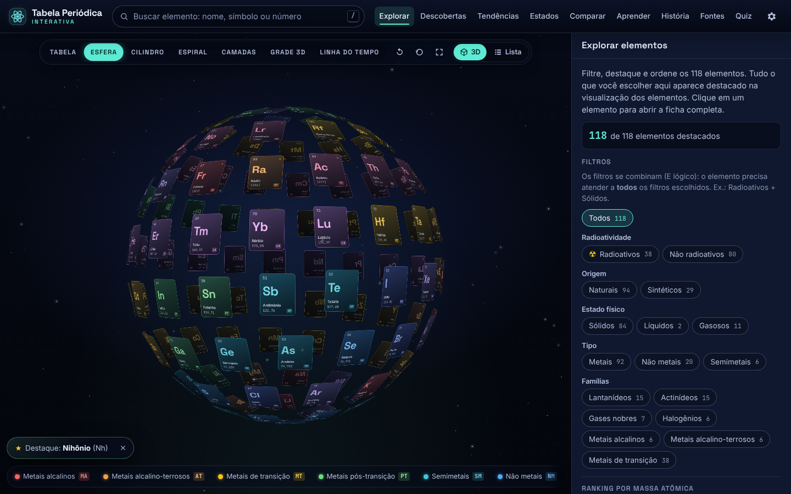
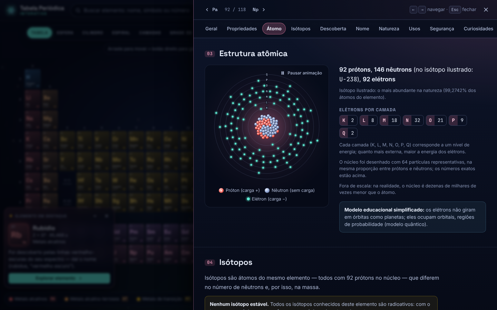
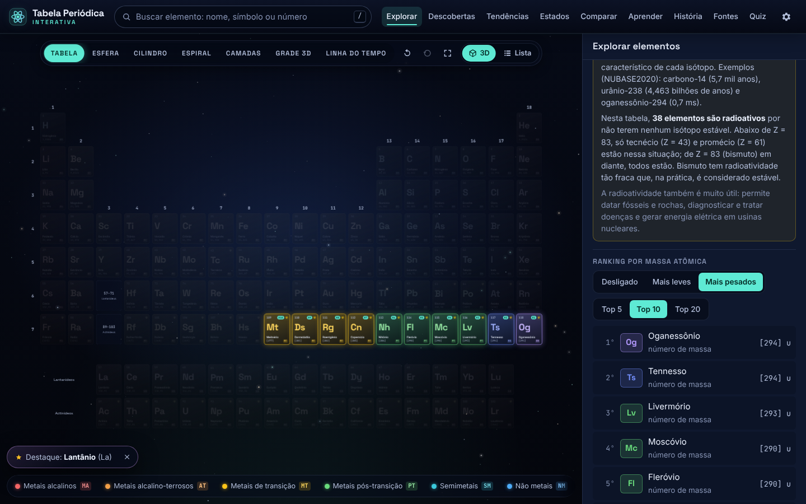
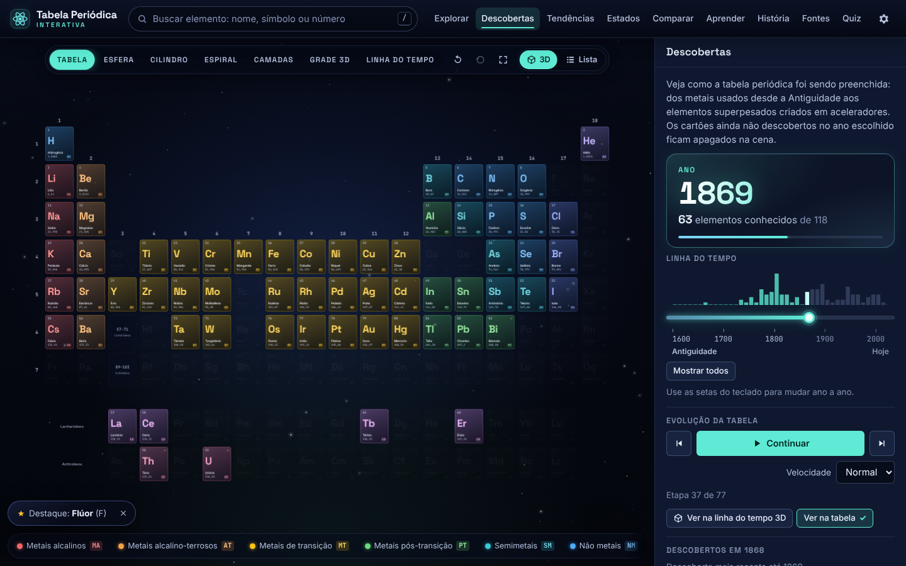
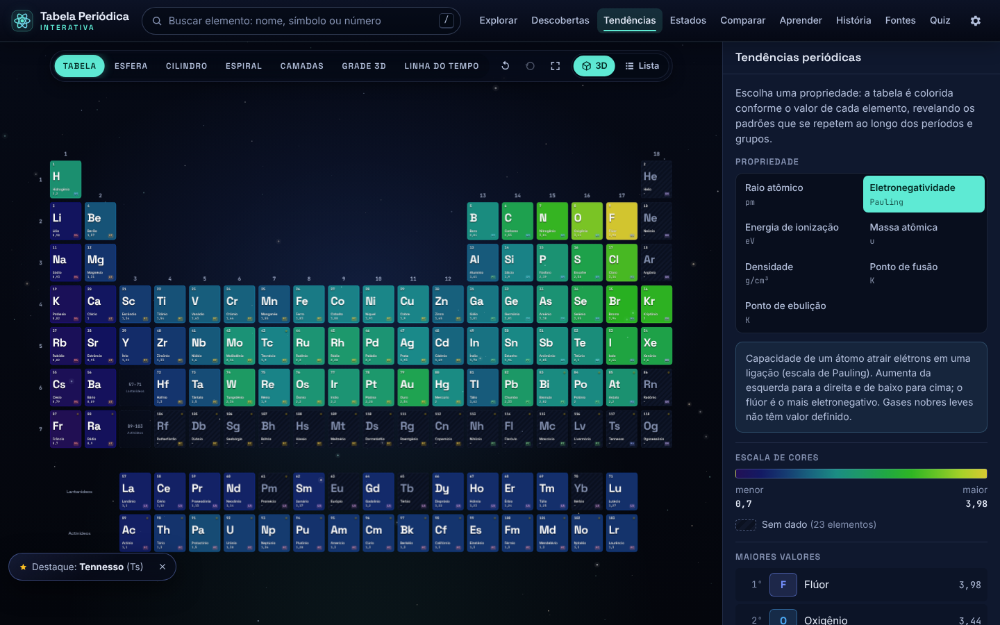
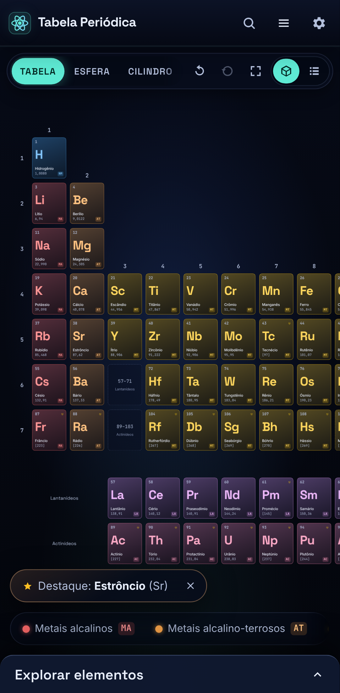

# Tabela Periódica Interativa

Uma tabela periódica **científica, educacional e interativa** com os **118 elementos químicos**, em português do Brasil.
Os cartões dos elementos se movem pelo espaço em 3D — da tabela tradicional para uma esfera, um cilindro, uma espiral,
camadas e outras formas — e cada elemento tem uma ficha completa com propriedades, estrutura atômica, isótopos,
história da descoberta, usos, riscos e fontes.



## Objetivo

Transformar a ideia visual de uma tabela periódica que "se reorganiza" no espaço em uma pequena **plataforma para
explorar os elementos químicos**: pesquisar, filtrar, comparar, ver tendências, viajar pela história das descobertas e
aprender os conceitos da química — sempre com dados de fontes científicas confiáveis e sem inventar informações.

## Funcionalidades

### Tabela periódica interativa
- Os 118 elementos no formato oficial da **IUPAC** (18 grupos, 7 períodos, séries de 15 lantanídeos e 15 actinídeos).
- Cada cartão mostra número atômico, símbolo, nome, massa atômica e a **sigla da categoria** (para não depender só da cor).
- Cores por categoria química com **legenda**: ao passar o mouse sobre uma categoria, os elementos dela são destacados.
- Clique nos **números dos grupos** (1–18) ou dos **períodos** (1–7) para destacar a coluna ou a linha.
- Tooltip rápido ao passar o mouse; ficha completa ao clicar.

### Visualização 3D animada
- Modos **Tabela, Esfera, Cilindro, Espiral, Camadas, Grade 3D** e **Linha do tempo**.
- Ao trocar de modo, **os próprios cartões voam** suavemente até as novas posições (não é uma troca de tela).
- O **cilindro** enrola a tabela "longa" de 32 colunas — a periodicidade vira um anel; as **camadas** separam os blocos
  s, p, d e f em planos de profundidade.
- Arrastar para girar ou mover, rolar para aproximar, rotação automática opcional, **resetar visualização** e **tela cheia**.
- **Qualidade gráfica** Automática, Baixa, Média ou Alta (a automática reduz efeitos em aparelhos modestos ou quando o
  sistema pede menos movimento).

### Filtros ("Explorar elementos")
- Todos, Radioativos, Não radioativos, Naturais, Sintéticos, Sólidos, Líquidos, Gasosos, Metais, Não metais,
  Semimetais, Lantanídeos, Actinídeos, Gases nobres, Halogênios, Metais alcalinos, Alcalino-terrosos e de Transição.
- **Filtros combinados** (por exemplo, "Radioativos" + "Naturais").
- Os elementos fora do filtro ficam esmaecidos — nunca somem — para que as posições continuem visíveis.

### Pesquisa
- Por nome ("Hidrogênio"), símbolo ("H"), número atômico ("1") ou parte do nome ("hidro"), com ou sem acentos.
- Aceita grafias alternativas ("Cromo", "Criptônio", "Netúnio") e até nomes de descobridores ("Curie").

### Elementos radioativos
- Filtro ☢ com explicação do que é radioatividade (alfa, beta, gama, meia-vida).
- Na ficha: se há isótopos estáveis, principais isótopos, meias-vidas, modos de decaimento, ocorrência natural ou
  produção artificial e riscos — com finalidade exclusivamente educacional.

### Mais leves e mais pesados
- Rankings **Top 5, 10 ou 20** por massa atômica, destacados na tabela e listados ao lado.
- Para elementos sem isótopos estáveis usa-se o número de massa do isótopo de vida mais longa entre colchetes, como
  recomenda o CIAAW.

### Histórico das descobertas
- Linha do tempo da Antiguidade até hoje: ao mover o controle, os elementos ainda não descobertos naquele ano ficam
  apagados (em 1869, ano da tabela de Mendeleev, eram 63 os elementos conhecidos).
- **"Ver evolução da tabela"** com Play, Pausa, Voltar e Avançar: os elementos surgem ano a ano, com o nome anunciado.
- Agrupamento por ano, descobridor, país, período histórico e método de descoberta.
- Em cada ficha: quem descobriu, quando, onde, como foi descoberto (contexto, experimento e confirmação) e **disputas de
  atribuição** registradas com as versões principais.

### Comparação
- Escolha de 2 a 4 elementos e tabela comparativa (massa, grupo, período, categoria, densidade, fusão, ebulição,
  eletronegatividade, raio atômico, energia de ionização e configuração eletrônica), com maior e menor valor destacados.
- Link compartilhável (`#/comparar/c,si,ge`).

### Tendências periódicas
- Raio atômico, eletronegatividade, energia de ionização, massa atômica, densidade, ponto de fusão e de ebulição,
  mostrados como um mapa de calor sobre a tabela, com legenda de escala e gráfico da propriedade × número atômico.

### Estado da matéria
- Sólidos, líquidos e gasosos a **25 °C e 1 atm**, e um controle de temperatura para ver o estado de cada elemento do
  zero absoluto à temperatura da superfície do Sol.

### Ficha completa do elemento
Informações gerais, propriedades, **estrutura atômica** (modelo educacional de camadas, com prótons, nêutrons e
elétrons), **isótopos**, descoberta, **como foi descoberto**, origem do nome e do símbolo, ocorrência na natureza,
principais usos, curiosidades, segurança e **fontes científicas**. Cada ficha tem endereço próprio
(`#/elemento/uranio`).

### Aprender e História
- **Aprender**: o que é elemento químico, número atômico, massa atômica, grupo, período, família, eletronegatividade,
  elétrons de valência, isótopos, radioatividade, por que a tabela tem esse formato e quem a criou.
- **História da Tabela Periódica**: Mendeleev, as lacunas e as previsões confirmadas (gálio, escândio e germânio), e a
  evolução até a tabela moderna (Moseley e o número atômico, os gases nobres, os actinídeos de Seaborg, os nomes de 2016).

### Extras
Elemento em destaque a cada visita, favoritos, histórico de elementos vistos, quiz "Qual é o elemento?", links
compartilháveis, vista em lista acessível para celulares e leitores de tela.

## Fontes científicas

Os dados numéricos não foram digitados à mão: são **gerados por scripts a partir de fontes primárias**.

| Dado | Fonte |
| --- | --- |
| Massas atômicas | IUPAC/CIAAW — *Abridged Standard Atomic Weights* (2024) e *Standard Atomic Weights* |
| Número de massa dos elementos radioativos | IUPAC/CIAAW — *Radioactive elements* (compilação da NUBASE2020) |
| Meias-vidas, decaimentos, massas isotópicas | NUBASE2020 — Kondev et al., *Chin. Phys. C* 45, 030001 (2021) |
| Composição isotópica | NIST — *Atomic Weights and Isotopic Compositions* |
| Propriedades físico-químicas | PubChem (NIH), agregando NIST, LANL, Jefferson Lab e IUPAC |
| Histórico, ocorrência e usos | Los Alamos National Laboratory, Jefferson Lab (via PubChem), páginas do CIAAW, IUPAC IPTEI |
| Descobertas dos elementos 101–118 | Relatórios técnicos IUPAC/IUPAP (1993, 2001, 2003, 2009, 2011, 2016) |
| Nomes em português | Sociedade Brasileira de Química — Tabela Periódica (2022) |

A lista completa, com DOIs conferidos, está no painel **Fontes científicas** da aplicação e em
[`src/data/sources.ts`](src/data/sources.ts). Os textos educativos de cada elemento foram escritos em português a
partir dessas fontes; quando as fontes divergem (por exemplo, o ano da descoberta do cobalto ou a prioridade do
oxigênio), a divergência é **explicada na ficha** em vez de escolhida em silêncio.

## Tecnologias

- **React 19 + TypeScript** (modo estrito) e **Vite**
- **Three.js** — `CSS3DRenderer` para os cartões em 3D (texto sempre nítido) e `OrbitControls` para a câmera
- CSS moderno (variáveis, `color-mix`, layout responsivo), fontes Inter, Space Grotesk e JetBrains Mono empacotadas
- **Vitest** + Testing Library para testes unitários e **Playwright** para testes no navegador
- Sem backend: os dados ficam em módulos TypeScript/JSON locais; os textos longos são carregados sob demanda

## Como instalar

Requisitos: **Node.js 22** ou superior.

```bash
git clone https://github.com/Helio965/Tabela-Periodica.git
cd Tabela-Periodica
npm install
```

## Como executar

```bash
npm run dev
```

Abra o endereço mostrado no terminal (normalmente `http://localhost:5173`).

## Como gerar o build

```bash
npm run build     # valida os dados, verifica os tipos e gera dist/
npm run preview   # serve o build localmente
```

O build usa caminhos relativos, então a pasta `dist/` pode ser publicada em qualquer servidor estático (inclusive
GitHub Pages).

## Testes e verificações

```bash
npm test               # testes unitários + validação da integridade dos 118 elementos
npm run test:e2e       # testes no navegador (Playwright), no desktop e no celular
npm run typecheck      # TypeScript (aplicação e testes e2e)
npm run check:links    # confere se os links das fontes respondem
npm run screenshots    # regenera docs/screenshots/ (com o app rodando; veja BASE_URL no script)
npm run data:fetch     # baixa novamente as fontes primárias para .cache/
npm run data:build     # regenera src/data/generated/*.json
```

Para os testes no navegador, instale antes o Chromium do Playwright (`npx playwright install chromium`) ou aponte
`CHROMIUM_PATH` para um Chromium já instalado.

- **Validação dos dados** (`src/data/validate.ts`): exatamente 118 elementos; números atômicos de 1 a 118 sem
  duplicatas; símbolos e nomes únicos; posições corretas na tabela; configurações eletrônicas que somam Z elétrons;
  categorias cadastradas; coerência entre radioatividade e isótopos; conteúdo educativo completo para todos os elementos.
- **Testes unitários** (Vitest, 237 testes): busca, filtros, rankings, comparação, tendências, linha do tempo, estado
  físico em função da temperatura, quiz, formatação em português, estado global e rotas, e as 7 disposições 3D (todos os
  cartões posicionados, sem sobreposição).
- **Testes no navegador** (Playwright, 13 cenários × desktop e celular): ficha, pesquisa, filtros combinados, ranking,
  troca de disposição 3D, comparação por link, evolução da tabela, todos os painéis, teclado e vista em lista — cada
  teste falha se aparecer qualquer erro no console.
- **Integração contínua** (GitHub Actions): testes, tipos, build e testes no navegador a cada push.

## Estrutura do projeto

```
scripts/
  fetch-sources.mjs      baixa as fontes primárias (CIAAW, NUBASE2020, NIST, PubChem)
  build-data.mjs         gera os dados numéricos a partir delas
  check-links.mjs        verifica os links externos
  screenshots.mjs        gera as capturas de tela do README
src/
  data/
    generated/           propriedades e isótopos gerados (JSON)
    elements/meta/       curadoria em português: nomes, categorias, descoberta
    elements/content/    textos educativos de cada elemento (carregados sob demanda)
    categories.ts        categorias químicas e cores
    sources.ts           registro das fontes científicas
    learn.ts, history.ts conteúdo das seções Aprender e História
    validate.ts          validações de integridade
  lib/                   lógica pura e testada: busca, filtros, rankings, tendências, linha do tempo…
  state/                 estado global, persistência e rotas por hash
  scene/                 motor 3D (CSS3D) e disposições: tabela, esfera, cilindro…
  components/            cabeçalho, busca, legenda, tooltip, lista…
  panels/                painéis: Explorar, Descobertas, Tendências, Estados, Comparar, Aprender, História, Fontes, Quiz
  sheet/                 ficha completa do elemento, modelo atômico e tabela de isótopos
e2e/                     testes Playwright
docs/screenshots/        capturas de tela usadas neste README
```

## Acessibilidade

Navegação completa por teclado (setas entre os elementos, Enter abre a ficha, Esc fecha), rótulos para leitores de
tela, contraste adequado, informação nunca transmitida só por cor (siglas, ícones e textos), respeito à preferência de
movimento reduzido e uma vista em lista como alternativa à cena 3D.

## Screenshots

| | |
| --- | --- |
|  |  |
|  |  |
|  |  |

## Licença

[MIT](LICENSE) © 2026 Hélio. Os dados científicos pertencem às respectivas fontes citadas.
